# Chapter 1 Story Graph — "Eighteen" (age 18 → first job)

Source of truth: `assets/content/story_ch1.json` (31 events, 105 nodes). The graph below is
the **event-level** flow. Inside each event, nodes branch by choice, challenge outcome and
condition-based routes.

```mermaid
flowchart TD
  R[ev_results_day<br/>Results Day<br/><i>choose: engineering / commerce / trade</i>] --> F[ev_family_money<br/>Household Notebook]
  F --> L[ev_library_mentor<br/>meet Mr. Fernandes · board puzzle]
  L --> P[ev_part_time_offer<br/>café job: take / decline]
  P -->|engineering| X[ev_entrance_exam<br/>UTAT · exam challenge]
  X --> XR{ev_exam_results}
  XR -->|government / private seat| B
  XR -->|drop year| DY[drop year: practise, work] --> RT[ev_utat_retake] --> RR{ev_retake_results}
  RR -->|seat| B
  RR -->|switch| A
  XR -->|switch course| A[ev_admissions<br/>B.Com / ITI]
  P -->|commerce / trade| A
  A --> B[ev_bank_fees<br/>bank account · loan / scholarship / self-fund]
  B --> D1[ev_first_day<br/>club / focus / friends]
  D1 --> K[ev_kavya_crisis<br/>show up · call later · text]
  K --> S1[ev_first_semester<br/>course puzzle challenge]
  S1 --> H[ev_amma_hospital<br/>savings / loan / double shifts / free ward]
  H --> E[ev_phone_emi<br/>EMI · cash · repair · live with it]
  E --> MP[ev_mentor_project<br/>requires mentor bond]
  E --> V[ev_kavya_venture<br/>requires dream shared + closeness]
  V -->|joined| VC[ev_venture_checkin<br/>case-study challenge or gut roll]
  MP --> I[ev_internship<br/>60% through course]
  VC --> I
  I --> FC[ev_final_crossroads<br/>Bengaluru / home / FixLab]
  FC -->|graduated| J[ev_job_interview<br/>interview challenge per career]
  FC -->|FixLab & graduated| FL[ev_fixlab_launch]
  J -->|offer| N[accept / negotiate]
  J -->|rejected or not ready| JR[ev_interview_retry<br/>every ~30 days] --> N
  JR -->|after 2+ interviews| END
  N --> FW[ev_farewell<br/>promise · visit · hug] --> END((Chapter conclusion))
  FL --> FW
```

**Recovery and world events** (can fire at any point when their conditions hold):

| Event | Trigger | Purpose |
|---|---|---|
| `ev_money_crisis` | arrears for 2+ months (repeatable) | family help, personal loan, café job, frugal mode, or drop out |
| `ev_burnout` | well-being ≤ 25 (repeatable) | rest, talk to Amma, push through |
| `ev_dropout_path` | left a course (repeatable) | re-enrol in ITI, or end the chapter (*Long Way Round*) |
| `ev_w_tuition` | random 12%/month | earn or volunteer as a tutor |
| `ev_w_monsoon` | random 25%/month, Oct–Dec | auto fare vs wading vs studying at home |
| `ev_w_harvest` | random 60%, January, farming background | the harvest obligation |
| `ev_w_kyc_scam` | random 10%/month after banking | phishing lesson (−₹5,000 or report it) |

## Persistent consequences (examples)

| Decision | Later effect |
|---|---|
| Kavya crisis: *show up* | memory `showed_up` → farewell variant, epilogue line, achievement; her trust unlocks FixLab |
| Kavya crisis: *text back* | memory `too_busy`, tension → colder farewell and epilogue |
| Hospital: *double shifts* | delayed consequence 30 days later: +₹12,000, −energy, −well-being, semester penalty |
| Hospital: *free ward* | delayed (21 days): recovery and closeness |
| Phone on EMI | 12 monthly ₹3,750 EMIs; missed EMIs hurt credit |
| Education loan | 9.5% interest accrues for years; EMIs start 6 months after the course |
| Mentor project | `has_reference` flag → interview variant and salary-negotiation leverage |
| Internship | `interned` → negotiation leverage, skill gain |
| Final term: Bengaluru | relocation on hire: 1.15× wages but rent and independent living |
| Farewell: send money home | 10% of every salary leaves each month, permanently |

## Chapter conclusions

| Priority | Conclusion | Condition |
|---|---|---|
| 60 | Something of Our Own | career = FixLab co-founder |
| 50 | The First Commit | software developer |
| 50 | Balanced Books | accountant |
| 50 | Live Wire | electrician |
| 0 | The Long Way Round | always (dropped out or stepped away from job hunting) |

Plus 14 condition-driven epilogue lines (debt, scholarship, hospital, Kavya, Mr. Fernandes,
drop year, backlog, scam, frugality, independence, ambition).
